# course-factory

<p>
  
  
  
  
  
</p>

**Turns a folder of university material (lecture notes, exercise sheets, labs, past exams) into an interactive course, written by local models on your own GPU.** Every Block of the course cites the page it came from, every model output is checked by plain code before you see it, and the course is built around how the exam actually asks its questions.

## How a Generation Run flows

```mermaid
flowchart LR
    A["Folder of PDFs"] --> B["Read every page<br/>text, formulas, figures"]
    B --> C["Propose Roles<br/>notes · exercises · labs · past exams"]
    C --> G1{{"Gate: check<br/>what was found"}}
    G1 --> D["Propose the outline<br/>Chapters · Sections · Concepts"]
    D --> G2{{"Gate: fix<br/>the outline"}}
    G2 --> E["Rebuild past papers<br/>sort Questions into types"]
    E --> F["Plan each Chapter<br/>then write its Sections"]
    F --> H["Check · repair · judge grounding"]
    H --> I["Mock exams · Labs"]
    I --> G3{{"Gate: review<br/>the Chapters"}}
```



The Run is a LangGraph graph with one thread per Course; the three Approval Gates are interrupts, so a Run survives a restart and resumes from its last finished step. Every model call goes through one seam (`pi_step.run_pi_step`): prompt from the Harness, structured output validated against a schema, and a Trace written with inputs, output, checks, model and duration. See [ADR 0001](docs/adr/0001-langgraph-outside-pi-inside.md).

## What a course is made of

A Section is an ordered list of **Blocks**, each one a typed Component with its own schema, checks and React renderer:

| Kind | Components |
|---|---|
| Explaining | `prose`, `intuition`, `theorem_box`, `key_formula`, `algorithm`, `callout`, `misconception`, `recap` |
| Showing | `worked_example`, `diagram`, `step_diagram`, `table`, `figure`, `plot`, `surface_plot`, `explorer`, `iteration_table`, `optimizer_animation`, `code`, `terminal` |
| Practising | `quiz`, `fill_blanks`, `exercise`, `code_exercise`, `explain_back` |

The model can also propose a new Component (schema, samples, a React implementation) when none fits; it is gated before it joins the Catalogue.

## Learning design, enforced by code

The rules come from the evidence summarised in [docs/research/learning-design.md](docs/research/learning-design.md) and [docs/research/sequencing.md](docs/research/sequencing.md), and are held by plain Python rather than by trusting the prompt:

- **Taught before asked.** Each Section declares the Concepts it teaches, each Concept in exactly one Section. A practice Block may test only Concepts already taught; one that names a later Concept is flagged.
- **Overview, then detail.** A Chapter plan opens with the big picture and what each Section adds. A Section opens by orienting the learner, and a formal statement comes after a concrete case.
- **A practice ramp.** Objectives carry a level (remember, understand, apply, analyse) and go from low to high; practice goes worked example, faded, independent, exam-style.
- **Explanation outweighs practice.** A plan with more practice than its objectives need is rejected, and a Section that asks more than it explains is reported.
- **Nothing skipped.** Readable course-notes pages cited by no Section are attached to the nearest one.
- **Visuals that carry information.** A visual is planned only for a relation that has a shape (process, hierarchy, comparison, cycle, state, quantity) and its type must match; trivial and overloaded diagrams are caught.
- **Grounded.** A Block marked `from_source` must cite real pages and is judged against them; maths claims (derivatives, gradients, Hessians, equalities) are verified with sympy; Mermaid and KaTeX are rendered in a check before a Block is accepted.

A Block that fails goes to a repair step; what still fails is flagged for review instead of stalling the Run.

## Studying with it

- **Read**: the course, with a Chapter map, citations that open the professor's page, and a flag on every Block.
- **Tutor**: answers from the Section's pages with citations, and can propose a new or replacement Block. "Explain differently" on any teaching Block asks for a simpler version, an example, an analogy or more depth.
- **Written answers and Explain back**: write (or photograph) an answer and have it graded step by step against a marking scheme, or self-mark when no model is available.
- **Cram**: past papers rebuilt into Questions and sorted into Question Types, a plan up to the exam date, exam technique per type, Mock exams, and a printable Cheat Sheet.
- **Cards**: spaced repetition (FSRS).
- **Labs**: lab sheets turned into step-by-step notebooks that run in Docker kernels, with a coach that sees your code and outputs.
- **Tablet**: pair a second device with a six-digit code.

## Quickstart

Requirements: Python 3.12 with [uv](https://docs.astral.sh/uv/), Node, the `pi` coding-agent CLI, and an OpenAI-compatible model server (developed against [llama-swap](https://github.com/mostlygeek/llama-swap)). Docker is only needed for Labs.

```bash
(cd web && npm ci && npm run build)
```

```bash
uv run course-factory
```

The app serves on `127.0.0.1:8765` and keeps its data in `~/.local/share/course-factory`.

### Configuration

| Variable | Meaning |
|---|---|
| `CF_MODEL` | Model for every step without its own (default `llama-swap/ninfer-qwen3.8-27b:medium`) |
| `CF_MODEL_<STEP>` | Model for one step, e.g. `CF_MODEL_JUDGE_GROUNDING` |
| `CF_FALLBACK_MODEL` | One extra attempt on this model after the retries |
| `CF_MODEL_CONCURRENCY` | Model calls at once (default 2); raise it only for a server configured for more |
| `CF_HOST` | `0.0.0.0` to reach the app from a paired tablet |

Per-step models can also be set in Settings. The model server's API key is read from the environment and is never stored in the repository.

### Tests

```bash
uv run pytest
```

```bash
uv run pytest -m slow
```

```bash
(cd web && npm run smoke)
```

The fast tests and the Playwright smoke tests run on a fake model, so they need no GPU; `-m slow` runs Lab kernels in real Docker. For UI work, `uv run python tests/fake_server.py` serves a seeded course on the fake model at `127.0.0.1:8766`.

### Comparing models

```bash
uv run python scripts/eval_models.py --course 1 --sections 6 llama-swap/<model-a> llama-swap/<model-b>
```

Writes the same Sections with each model on a copy of the database and prints time, failed calls, Blocks flagged, grounding verdicts and the split between teaching and practice.

## Project layout

```
src/course_factory/   the pipeline and the API
  generation.py       the Run as a LangGraph graph
  pi_step.py          the one seam every model call goes through
  outline.py          Chapters, Sections, Concepts
  lesson_plan.py      the Chapter plan and its rules
  chapters.py         writing, checking, repairing, judging Sections
  checks.py           per-Component checks
  cram.py, exams.py   Question Types, past papers, Mock exams
  tutor.py, grading.py, labs.py, learner.py
harness/              one prompt per model step
web/                  the React UI (Vite, Tailwind, KaTeX, Mermaid, Plotly)
tests/                pytest on a fake model, plus the fake server
docs/                 ADRs, research, the vision after v1
CONTEXT.md            the domain vocabulary used in code and prompts
```

## Status

A single-user tool under active development. What comes after v1 is described in [docs/VISION.md](docs/VISION.md).
